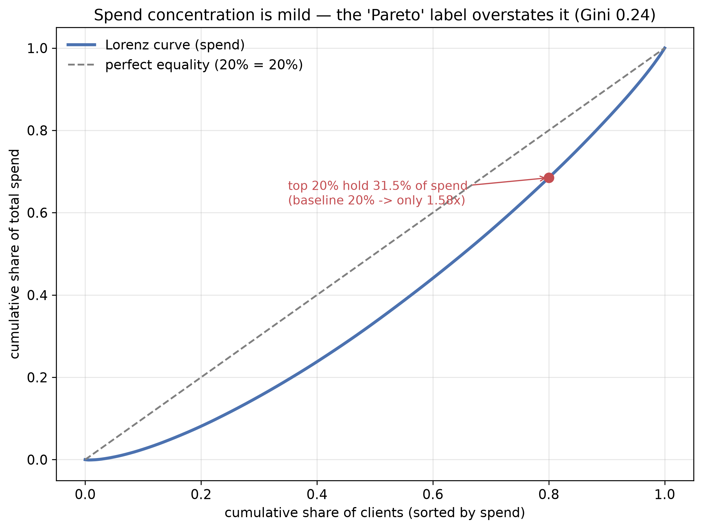

<!-- ascii-art: pyfiglet + ascii-bin (CC0) -->
```text
             _   _
 _ __  _   _| |_| |__   ___  _ __
| '_ \| | | | __| '_ \ / _ \| '_ \
| |_) | |_| | |_| | | | (_) | | | |
| .__/ \__, |\__|_| |_|\___/|_| |_|
|_|    |___/

╭──────────────────────────────────────────────────────────────────────────╮
│ Аналитическому портфолио нужен воспроизводимый каркас, а не набор раз... │
╰──────────────────────────────────────────────────────────────────────────╯
━━━━━━━━━━━━━━━━━━━━━━━━━━━━━━━━━━━━━━━━━━━━━━━━━━━━━━━━━━━━━━━━━━━━━━━━━━━━
```

# Python Analytics Playground

[](https://github.com/NikitaBoyarkin/python/actions/workflows/ci.yml)

> Пайплайн Python-аналитики (загрузка → очистка → EDA → визуализация) на синтетике seed=42; **34 теста** и порог покрытия **≥80 %**.

## Навигация
- 🌐 [Портфолио](https://nikitaboyarkin.github.io)
- 🏦 [Флагманский кейс: Volta neobank](https://github.com/NikitaBoyarkin/volta-banking)
- 🧪 Связанные: [rfm-analysis-of-bank-clients](https://github.com/NikitaBoyarkin/rfm-analysis-of-bank-clients) · [sql-analytics-case-study](https://github.com/NikitaBoyarkin/sql-analytics-case-study) · [churn-prediction](https://github.com/NikitaBoyarkin/churn-prediction)

**▶ [Диаграмма: Reproducible Python analytics pipeline](docs/diagrams/python.html)** — открывается в браузере, без установки и сборки

**Public link:** [демо](https://nikitaboyarkin.github.io/demos/python/index.html) · [кейс](https://nikitaboyarkin.github.io/projects/python/) · [исходники](https://github.com/NikitaBoyarkin/python)

**На этой странице:** [Ситуация](#ситуация) · [Задача](#задача) · [Действия](#действия) · [Результат](#результат) · [Структура](#структура) · [Запуск](#запуск) · [Пример](#пример) · [PRD](#prd)

## Ситуация

Аналитическому портфолио нужен воспроизводимый каркас, а не набор разрозненных
скриптов: одно место, где загрузка, очистка, разведочный анализ и графики
собраны в повторяемый пайплайн и покрыты тестами.

**Данные.** Синтетические фикстуры, а не публичный датасет:
`generate_synthetic_data(n=1000, seed=42)` (`src/python_analytics/pipeline.py`)
пишет `data/synthetic.csv` из трёх нормальных распределений. Воспроизвести:
`uv run python -m python_analytics`.

## Задача

Собрать модульный пакет `python_analytics` со сквозным пайплайном и держать
покрытие тестами на уровне **≥80 %** (`pyproject.toml`).

## Действия

- Загрузка и очистка — `load_csv`, `clean_missing(strategy="fill")`, `deduplicate` (`src/python_analytics/load.py`, `clean.py`).
- EDA — `describe`, `missing_report`, `correlation_matrix` (`src/python_analytics/eda.py`).
- Визуализация — `plot_hist`, `plot_corr_heatmap` (`src/python_analytics/viz.py`).
- Сквозной пайплайн — `run_pipeline()` генерирует синтетику, чистит, считает EDA и рисует графики (`src/python_analytics/pipeline.py:30`).
- Отчёты в Markdown — `generate_report` (`report.py`) и `segmentation_report` (`segment.py`).
- Сегментация — возрастные когорты, `value_segments` (квартили по `spend`), `high_value_share` — правило Парето (`src/python_analytics/segment.py`).


*Распределение `spend` по клиентам: кривая Лоренца и точка топ-20 % против линии полного равенства. Оговорка: данные синтетические и признаки независимы, поэтому концентрация слабая — ярлык «Парето» её завышает (`reports/eda/findings.md`), и график показывает работу метрики, а не продуктовый вывод.*

## Результат

- **34 теста** — `tests/` (7 clean + 4 eda + 4 load + 2 pipeline + 1 report + 14 segment + 2 viz).
- **≥ 80 %** — порог покрытия `--cov-fail-under=80` (`pyproject.toml`).
- **1 000 строк** — синтетика по умолчанию: `generate_synthetic_data(n=1000, seed=42)` + 5 дубликатов и 21 пропуск в `income` (`pipeline.py:16`).
- **2 отчёта** — `reports/report.md` и `reports/segmentation_report.md`.

## Решение

Репозиторий доказывает, что пайплайн загрузка → очистка → EDA → визуализация собирается в пакет,
прогоняется одной командой на синтетике `seed=42` и удерживается тестами — **34 теста** при
пороге покрытия **≥80 %**. Это процессный результат: он говорит о воспроизводимости и дисциплине
тестов, а не о свойствах данных.

Инсайтов о поведении клиентов здесь нет и быть не может: фикстуры синтетические, признаки
независимы, поэтому даже концентрация трат на графике Лоренца слабая и ярлык «Парето» её
завышает. Всё, что лежит в `reports/`, относится к работе метрик, а не к продуктовой картине.

Читать стоит как переиспользуемый каркас и шаблон нового анализа: модули, тесты и отчёты
переносятся на реальный датасет без переписывания, но числа из «Результата» описывают сам
пайплайн, а не бизнес.

## Структура

```
src/python_analytics/
├── load.py       # загрузка CSV (REQ-002)
├── clean.py      # пропуски, дубликаты, типы (REQ-003)
├── eda.py        # статистика, пропуски, корреляции (REQ-004)
├── viz.py        # гистограммы, тепловые карты (REQ-005)
├── segment.py    # когорты, value_segments, high_value_share
├── report.py     # Markdown-отчёты: generate_report (REQ-009)
├── pipeline.py   # end-to-end пайплайн (REQ-006)
└── __main__.py   # точка входа для `python -m python_analytics`
```

`input.py`, `print.py`, `variables.py` — ранние учебные скрипты, сохранены для истории.

## Запуск

Требуется `uv` и Python ≥ 3.10 (`requires-python = ">=3.10"` в `pyproject.toml`).

```bash
uv sync --all-groups
uv run pytest                          # тесты + покрытие (≥80%)
uv run python -m python_analytics      # end-to-end пайплайн
```

## Пример

```python
from python_analytics.load import load_csv
from python_analytics.clean import clean_missing, deduplicate

df = load_csv("data/synthetic.csv")
df = clean_missing(df, strategy="fill")
df = deduplicate(df)
```

## PRD

Полный PRD: `docs/prd.md`. Vault-заметка: `PRD - Python Analytics Playground` — в приватном Obsidian-хранилище (Z-core), извне недоступна.
