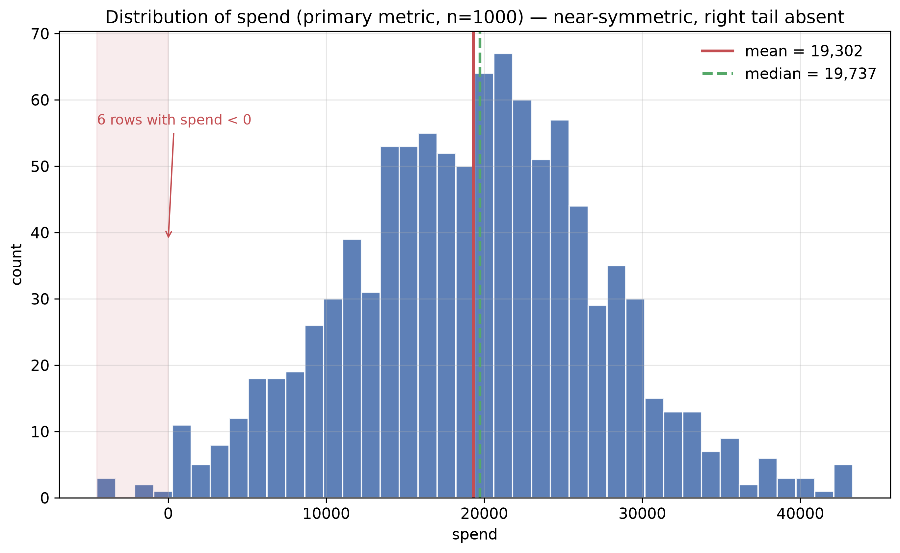
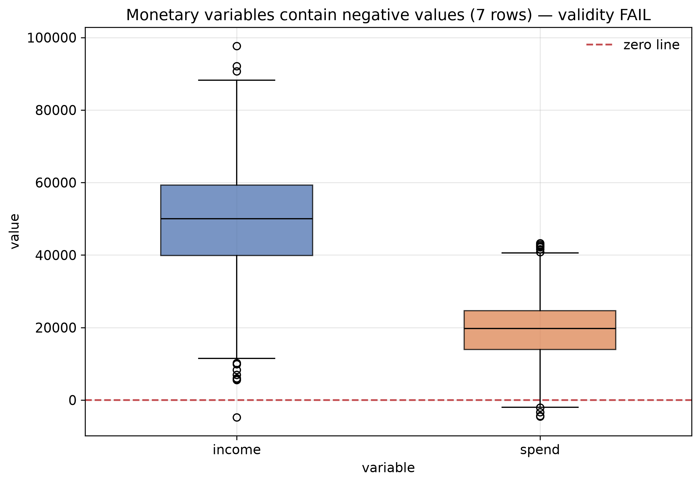
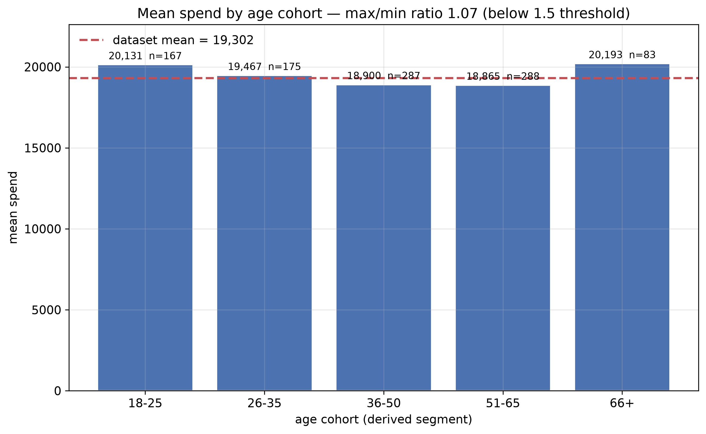
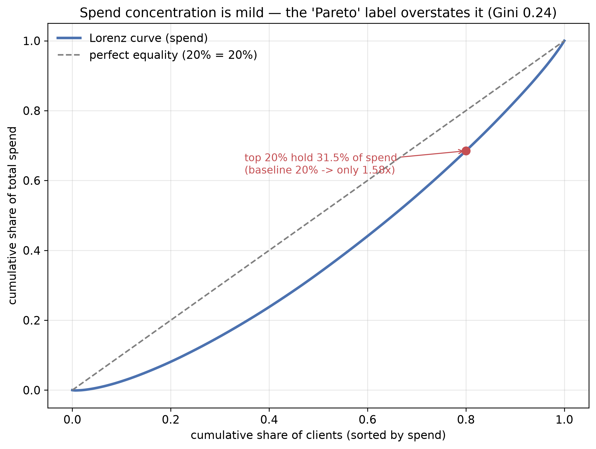
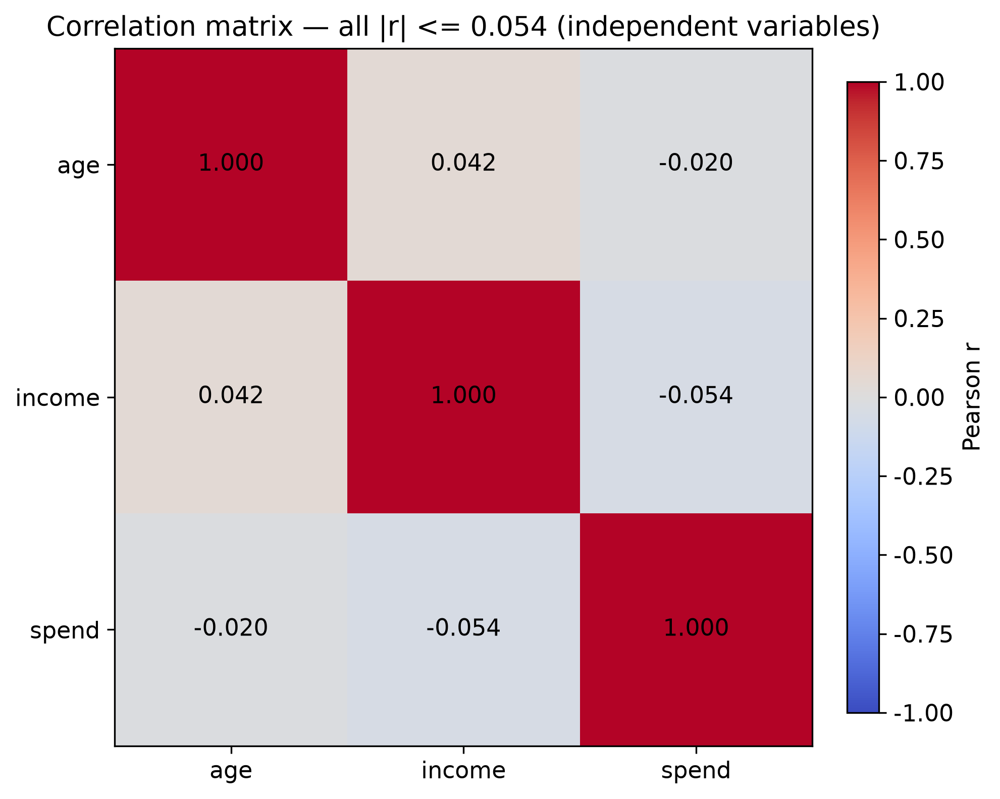

# EDA — Python Analytics Playground (`data/synthetic.csv`)

> [!summary]
> Синтетический cross-sectional датасет на 1005 строк (после дедупликации — 1000) с тремя
> колонками: `age`, `income`, `spend`. Разбирали как демо-поверхность учебного пайплайна
> `python_analytics`: проверили качество, распределения, сегментацию и заявленные в README
> числа. Главное: данные — независимый гауссов шум без структуры, поэтому ни один
> «аналитический» вывод на них не воспроизводим; два заявления README/отчётов расходятся
> с данными (пропуски, ярлык «Pareto»).

## Executive Summary

- **Датасет:** `data/synthetic.csv`, синтетика `seed=42`; 1005 строк × 3 колонки (1000 после дедупликации). Временного периода нет — данные cross-sectional.
- **Grain:** одна строка = один синтетический клиент. Ключа нет; дубликаты = намеренно вставленные первые 5 строк.
- **Целевая метрика:** `spend` — медиана 19 737, p95 32 389 (mean 19 302, skew −0.02 → форма близка к нормальной).
- **Главный разрыв:** по производным сегментам разрыва нет — max/min среднего `spend` между возрастными когортами = **1.07** (порог 1.5 не достигнут); top-20% дают **31.5%** трат (Gini 0.24).
- **Состояние данных:** приемлемое для демо, но есть проблемы: **21** пропуск в `income`, **7** строк с отрицательными денежными значениями (валидность FAIL), переменные статистически независимы.
- **Главный вывод:** датасет — корректный тест-стенд пайплайна, но не носитель продуктового нарратива; ярлык «Pareto» в `segmentation_report.md` завышает концентрацию.

## Профиль

| Колонка | dtype | n (non-null) | Кардинальность |
|---|---|---|---|
| age | int64 | 1005 | 52 |
| income | float64 | 984 | 1005 (непрерывная) |
| spend | float64 | 1005 | 1005 (непрерывная) |

Память: 0.02 MB. Категориальных колонок нет, datetime-колонок нет. Константных колонок нет.

## Качество данных

| Проблема | Величина | Решение |
|---|---|---|
| Пропуски в `income` | 21 (2.1%) | Импутация медианой (`clean_missing(strategy="fill")`) — пропуск MCAR по конструкции, доля < 5%, риск смещения минимален |
| Полные дубликаты | 5 строк | `deduplicate()` удаляет; дубликаты намеренные (`df.iloc[:5]` в генераторе) |
| Отрицательные `spend` | 6 строк | Ошибка данных (генератор `np.random.normal` без обрезки) — не удалять, а чинить генератор |
| Отрицательные `income` | 1 строка | То же |
| Выбросы по IQR | age 0.0%, income 0.9%, spend 1.1% | Ниже порога 5% — сигнал/ошибка не разбираются |

## Валидность

| Колонка | Проверка | Результат | Заметка |
|---|---|---|---|
| age | 0 ≤ age ≤ 120 | PASS | диапазон 18–69 |
| income | ≥ 0 (денежная) | FAIL | 1 строка < 0 (min −4726.19) |
| spend | ≥ 0 (денежная) | FAIL | 6 строк < 0 (min −4510.24) |
| income | не будущее / не раньше старта | N/A | временной колонки нет |
| spend_rate | 0 ≤ rate ≤ 1 (при заявленной семантике) | FAIL | 7 значений < 0, min −7.62; max 3.92 |

## Бизнес-логика

| Проверка | Результат | Заметка |
|---|---|---|
| `revenue коррелирует с orders` | N/A | колонок orders/revenue нет |
| Суммы по сегментам сходятся с агрегатом | PASS | `share_of_total` по value-сегментам суммируется в 1.0000; Парето воспроизведён (31.5%) |
| Производные колонки сверены с источником | PASS | `age_group`, `value_seg`, `spend_rate` повторяют логику `segment.py`; числа совпали с `segmentation_report.md` |
| Известная связь доход↔траты | FAIL (ожидаемо для синтетики) | `income`↔`spend` r = −0.054 — связи нет |

## Распределения

| Колонка | mean | median | std | p25 | p75 | p95 | skew | outliers |
|---|---:|---:|---:|---:|---:|---:|---:|---:|
| age | 43.64 | 44.0 | 14.99 | 30.0 | 57.0 | 67.0 | −0.03 | 0.0% |
| income | 49 597.77 | 50 032.5 | 15 208.15 | 39 545.8 | 59 483.0 | 74 293.9 | −0.12 | 0.9% |
| spend | 19 301.83 | 19 737.47 | 8 077.90 | 13 982.7 | 24 664.9 | 32 388.9 | −0.02 | 1.1% |

Все три распределения близки к нормальным (|skew| ≪ 0.5), поэтому среднее и медиана
совпадают в пределах шума; лог-трансформация не требуется. Единственная асимметрия —
короткий левый хвост из-за отрицательных значений (см. `fig1`, `fig2`).

## Сегменты

Разрезов в исходных данных нет — сегменты производные, повторяют логику проекта.

**По возрастным когортам** (`age_group`), метрика `spend`:

| Сегмент | count | mean | median | sum | share_of_total | откл. от mean |
|---|---:|---:|---:|---:|---:|---:|
| 18-25 | 167 | 20 130.5 | 20 317.6 | 3 361 794 | 0.1742 | +4.3% |
| 26-35 | 175 | 19 466.6 | 19 995.5 | 3 406 652 | 0.1765 | +0.9% |
| 36-50 | 287 | 18 900.1 | 18 833.5 | 5 424 335 | 0.2810 | −2.1% |
| 51-65 | 288 | 18 864.6 | 19 703.3 | 5 432 999 | 0.2815 | −2.3% |
| 66+ | 83 | 20 193.4 | 20 703.7 | 1 676 049 | 0.0868 | +4.6% |

**Главный разрыв:** max/min среднего = 20 193 / 18 865 = **1.07** — ниже порога `SEGMENT_GAP_WARN` 1.5.
Разрыв объясняется не поведением, а малой выборкой (n=83 у когорты `66+`); это не кандидат
в главный вывод. `spend_rate` по когортам колеблется в диапазоне 0.428–0.470 — тоже без разрыва.

**По value-сегментам** (квартили `spend`):

| Сегмент | count | mean | median | sum | share_of_total |
|---|---:|---:|---:|---:|---:|
| Low | 250 | 8 929.1 | 9 892.3 | 2 232 286 | 0.1157 |
| Medium-Low | 250 | 16 861.0 | 16 844.2 | 4 215 246 | 0.2184 |
| Medium-High | 250 | 22 039.8 | 21 901.4 | 5 509 945 | 0.2855 |
| High | 250 | 29 377.4 | 28 225.5 | 7 344 352 | 0.3805 |

## Динамика и аномалии

Не применимо: в датасете нет временной колонки (ни `date`, ни `period`), данные
cross-sectional. Недельную динамику и период-к-периоду считать не на чем. Фаза 5
пропущена осознанно; при появлении истории транзакций — вернуться сюда.

## Findings (E / H / R)

### Finding 1: Переменные статистически независимы — датасет не несёт продуктового сигнала

**Evidence:**
- `income`↔`spend` r = −0.054; `age`↔`spend` r = −0.020; `age`↔`income` r = 0.042.
- Максимальный |r| = 0.054 — на порядок ниже порога `CORR_WARN` 0.8 и ниже даже 0.5.

**Hypothesis:**
- H1: генератор (`generate_synthetic_data`) тянет `age`, `income`, `spend` тремя
  независимыми вызовами `rng` → любая связь отсутствует по конструкции.
- H2 (альтернативная): связь есть, но скрыта нелинейностью или выбросами. `[❓ требует валидации]`

**Recommendation:**
- Действие: для демо-пайплайна это допустимо, но нельзя строить на этих данных никакой
  «найденной зависимости». Либо добавить в генератор связь (например `spend = f(income)` + шум),
  либо подключить реальный датасет.
- Рычаг: `методология (достоверность демо)`
- Сценарий проверки: сгенерировать данные с известной корреляцией и убедиться, что
  `correlation_matrix` её находит.
- Приоритет: **M**

### Finding 2: Отрицательные денежные значения — ошибка генератора (validity FAIL)

**Evidence:**
- 6 строк с `spend < 0` (min −4 510.24), 1 строка с `income < 0` (min −4 726.19).
- 7 значений `spend_rate < 0` (min −7.62), что физически бессмысленно при семантике «доля дохода на траты».

**Hypothesis:**
- H1: `np.random.normal(20000, 8000, n)` даёт левый хвост ниже нуля; обрезки нет.
- H2: отрицательные — намеренный «возврат/refund». `[❓ требует валидации]` — но `spend_rate` тогда
  должен быть задокументирован как знаковый.

**Recommendation:**
- Действие: обрезать `spend`/`income` снизу нулём (`np.clip`) или генерировать логнормально.
- Рычаг: `качество данных` (влияет на mean, sum, любые ratio)
- Сценарий проверки: тест на отсутствие отрицательных значений после генерации.
- Приоритет: **H**

### Finding 3: Ярлык «Pareto» в `segmentation_report.md` завышает концентрацию

**Evidence:**
- `segmentation_report.md` сообщает «top-20% клиентов дают 31.5% трат» — число **воспроизведено**.
- Но при равномерном распределении top-20% дали бы 20%; 31.5% — это всего **1.58×** базовой линии.
- Gini по `spend` = 0.24 (умеренное неравенство), а не классическое 80/20.

**Hypothesis:**
- H1: функция `high_value_share` названа «Pareto» условно, без проверки самого правила 80/20.
- H2: 31.5% — статистическая флуктуация одного нормального розыгрыша. `[❓ требует валидации]`

**Recommendation:**
- Действие: переименовать метрику в «concentration share» либо добавить рядом Gini/Lorenz;
  не заявлять правило Парето без порога.
- Рычаг: `методология (корректность отчёта)`
- Сценарий проверки: сравнить `high_value_share` с Gini на распределении с известной концентрацией.
- Приоритет: **M**

### Finding 4: README заявляет 20 пропусков — в CSV их 21

**Evidence:**
- В `data/synthetic.csv` пропусков в `income` = **21** (2.1%), README (строка 36) — «20 пропусков в `income`».
- Механизм: `rng.integers(0, n, 20)` даёт 20 уникальных NaN в базовых 1000 строках, но
  среди продублированных первых 5 строк одна содержит NaN → в итоговых 1005 строках их 21.

**Hypothesis:**
- H1: README описывает намерение (20 вставок), а не фактическое содержимое файла.

**Recommendation:**
- Действие: поправить число в README на 21 либо генерировать пропуски после конкатенации
  (`sample` без повторений на финальном фрейме).
- Рычаг: `документация`
- Сценарий проверки: assert `df["income"].isna().sum() == 21` в тестах генератора.
- Приоритет: **L**

## Что не вошло

- **Временная динамика и аномалии (Фаза 5):** нет колонки времени — считать нечего. Вернуться при появлении транзакционной истории.
- **Проверка гипотез и A/B:** нет назначения групп и pre/post-периода; это EDA, а не CDA.
- **Реальная валидность генератора:** не сверяли `generate_synthetic_data` с внешним источником — сравнивать не с чем, данные синтетические.
- **Полный тест-ран с покрытием:** запущен только `pytest --collect-only` (34 теста собраны); фактическое покрытие ≥80% не перепроверялось, чтобы не менять артефакты проекта.
- **Остальные учебные скрипты** (`input.py`, `print.py`, `variables.py`) — вне данных, не разбирались.
- **Границы `age_group`** (`66+` включает 120) — доменный выбор проекта, не проверялся на реальных данных.

## Чеклист

- [x] 40 пунктов `references/eda_checklist.md` пройдены (в объёме, применимом к cross-sectional данным без времени).
- [x] Все FAIL (отрицательные денежные значения) задокументированы; риск принят как «демо-данные».
- [x] Выжимка записана по `assets/findings_summary.md` → `reports/eda/findings.md`.
- [x] «Что не вошло» заполнено.
- [x] README truth check выполнен (см. ниже).

## Truth check (portfolio invariant: правда → глубина → нарратив)

| Заявление README | Метод | Вердикт | Значение |
|---|---|---|---|
| **34 теста** (`tests/`) | `pytest --collect-only` | **REPRODUCED** | `34 tests collected`; разбивка 7+4+4+2+1+14+2 совпала |
| Порог покрытия **≥80%** (`--cov-fail-under=80`) | чтение `pyproject.toml` | **REPRODUCED** | опция присутствует в `[tool.pytest.ini_options].addopts` |
| **1 000 строк** — синтетика `n=1000, seed=42` | реконструкция пайплайна | **REPRODUCED** | raw 1005 → после `deduplicate` 1000 |
| **5 дубликатов** | `df.duplicated().sum()` на raw | **REPRODUCED** | 5 |
| **20 пропусков в `income`** | `df["income"].isna().sum()` на raw | **MISMATCH** | заявлено **20**, фактически **21** (2.1%) |
| **2 отчёта** (`report.md`, `segmentation_report.md`) | наличие файлов | **REPRODUCED** | оба файла на месте |
| Pareto: **top-20% дают 31.5% трат** | пересчёт `high_value_share` | **REPRODUCED** | 0.3151 (но ярлык «Pareto» оспорен — Finding 3) |

## Figures

| Файл | Что показывает |
|---|---|
| `figures/fig1_spend_distribution.png` | Распределение `spend` (метрика): near-symmetric, зона отрицательных значений |
| `figures/fig2_quality_boxplot.png` | Boxplot `income`/`spend` с отрицательными хвостами (validity FAIL) |
| `figures/fig3_spend_by_age.png` | Средний `spend` по возрастным когортам (производный сегмент) |
| `figures/fig4_lorenz_pareto.png` | Lorenz-кривая трат — главный вывод (концентрация мягкая) |
| `figures/fig5_correlation.png` | Матрица корреляций — независимость переменных |











## Reproducibility

```bash
EDA="/Users/nikitaboarkin/Desktop/00 ide/00 portfolio/.eda-tools/.venv/bin/python"
PROF="/Users/nikitaboarkin/Desktop/00 obsidian/obsidian/.claude/skills/eda/scripts/eda_profile.py"

# Профиль
"$EDA" "$PROF" --input data/synthetic.csv --metric spend \
    --out reports/eda/scripts/_profile_raw.md

# Числа и truth check
"$EDA" reports/eda/scripts/analysis.py

# Фигуры
"$EDA" reports/eda/scripts/plot_figures.py
```

Сырой профиль: `reports/eda/scripts/_profile_raw.md`. Сводка чисел: `reports/eda/scripts/_summary.json`.
